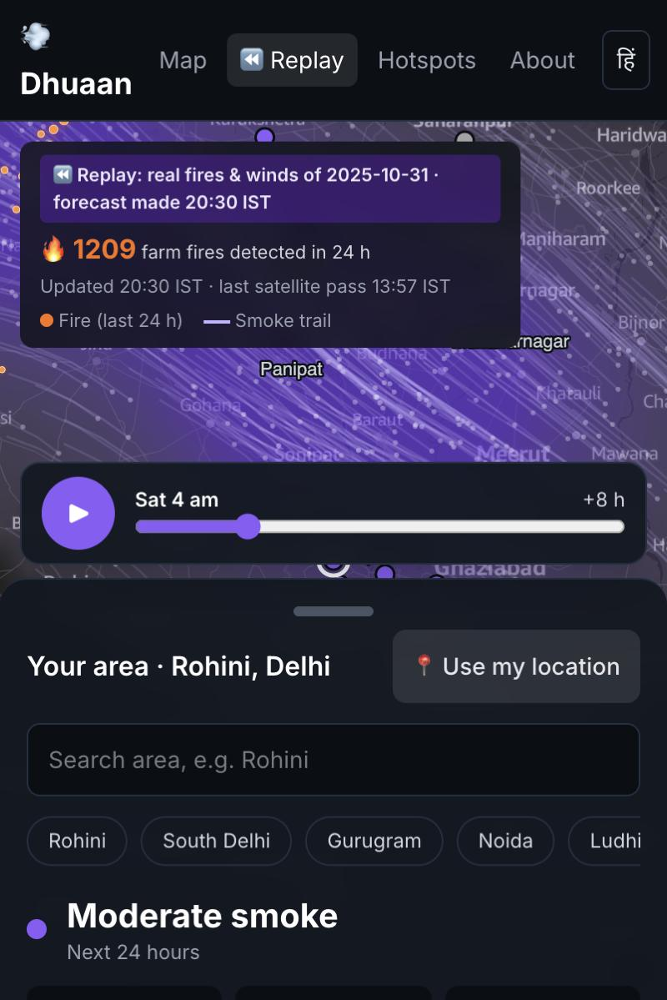
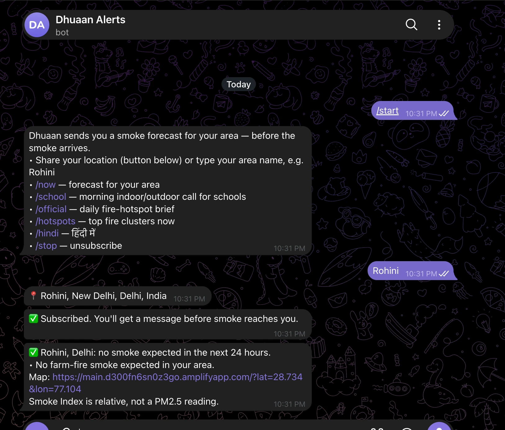
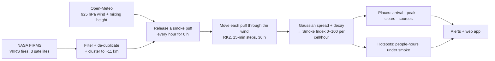
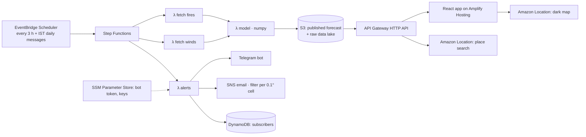

# Dhuaan · धुआँ

**A weather forecast for smoke.** Dhuaan follows the smoke from farm fires that NASA satellites detect across Punjab, Haryana and beyond. It predicts **when** smoke will reach your area, **how heavy** it will be and **where it's coming from**, up to 36 hours ahead. Then it messages you in Hindi or English before it arrives.

> धुआँ आने से पहले, ख़बर आपके फ़ोन पर।

**Live app:** https://main.d300fn6sn0z3go.amplifyapp.com
**Replay of a real bad night (31 Oct 2025):** https://main.d300fn6sn0z3go.amplifyapp.com/?replay=2025-10-31 (press ▶)
**Telegram alerts:** [@DhuaanSmokeBot](https://t.me/DhuaanSmokeBot). Send your area name (e.g. `Rohini`) or share your location.

Built for *Environmental Hacks* (WeMakeDevs × AWS, Bharat Builds Tour), Track 01: **Air**.

<p>
  
  
</p>

---

## The problem

Every October and November, crop-residue fires burn across north India. Satellites detect them within hours, yet the smoke still reaches Delhi and dozens of towns as a surprise. It often arrives at night, when a shallow mixing layer traps it near the ground. AQI apps tell you the air is bad once you're already breathing it. Nobody tells a parent at 10 PM that smoke from fires near Sangrur will be over Rohini by 3 AM.

Not all fires matter equally either. Which clusters will put smoke over the most people tomorrow depends on the wind, and the people sending crop-residue machinery or field teams have no ranking to work from.

## What Dhuaan does

- **Forecasts smoke for any place in the region** for the next 36 hours, hour by hour: when it arrives, when it's heaviest, when it clears.
- **Says where it's coming from**: "mostly from farm fires near Sangrur (34%) and Mansa (17%)".
- **Alerts people before it arrives**: Telegram (or email), in English or Hindi, with plain protective steps. Schools get a 6:30 AM indoor/outdoor call for assembly and PE.
- **Ranks fire clusters by impact**: people-hours under smoke in the next 24 h, so help goes where it matters most. On 31 Oct 2025, the top 25 clusters caused 62% of Delhi's modelled smoke.
- **Replays real past days** with only the information that was available at the time, so anyone can check how it would have done.

## How the forecast works



1. **Fires.** We take VIIRS 375 m active-fire detections (S-NPP, NOAA-20, NOAA-21) inside 72.5–78.5°E, 27.5–32.6°N. We drop low-confidence points and known industrial flares, merge the same fire seen by different satellites, and group fires into 0.1° clusters weighted by fire radiative power (FRP).
2. **Wind.** We use hourly 925 hPa winds (~750 m, inside the smoky boundary layer) on a 0.5° grid, plus boundary-layer height, from yesterday through +2 days. 10 m winds are the fallback.
3. **Trajectories.** Each cluster releases one puff per hour for 6 hours, carrying FRP/6. Puffs are moved with a midpoint (RK2) integrator in 15-minute steps. This is the same idea as NOAA's HYSPLIT, much simplified.
4. **Smoke Index.** Each puff spreads (σ = 5 km + 3 km/h × age, capped at 80 km) and fades (24 h e-folding). Summed puffs give a relative index, scaled so that 1,000 MW of fires 150 km upwind with a 5 m/s wind peaks at 80. A shallow night-time mixing layer raises the index, up to ×3, because smoke gets trapped.
5. **Levels.** <15 none · 15–35 light · 35–60 moderate · ≥60 heavy. An alert goes out when an area is forecast to reach moderate within 24 h.

**Limits.** The Smoke Index is relative. It is not a PM2.5 measurement or an AQI forecast, and local traffic, dust and industry aren't in it. Fires lit after the afternoon satellite pass only show up on the next pass. Parameters and their sources are in [`backend/src/engine/data/parameters.json`](backend/src/engine/data/parameters.json) and [`docs/sources.md`](docs/sources.md).

## Does it match reality? A replay of 31 Oct 2025

The replay uses only the fires known at 20:30 IST on 31 Oct 2025 (1,209 detections) and the winds as forecast then. It shows smoke reaching north Delhi around **03:30 IST on 1 Nov**, peaking around 06:30 and clearing by about 10:30, mostly from fires near Sangrur and Mansa.

What was observed: Delhi's AQI rose from **218 to 251** on 1 Nov, with 8 stations "very poor". The worst was **Wazirpur (333) in north-west Delhi**, the side the model says the smoke reached first ([CPCB via The Daily Guardian](https://thedailyguardian.com/india/delhi-aqi-on-novenmebr-1-2025-delhi-breathes-polluted-air-again-aqi-touches-251-mark-677349/)). One day is not proof, and AQI includes local sources, but the direction and timing are consistent.

## Architecture on AWS



| AWS service | What it does in Dhuaan |
|---|---|
| EventBridge Scheduler | Runs the pipeline every 3 hours; sends school (06:30), resident (07:00) and official (08:00) messages on IST schedules |
| Step Functions | Orchestrates fetch fires ‖ fetch winds → model → alerts, with retries |
| Lambda (Python 3.12, arm64) | Five functions: fetch fires, fetch winds, model, alerts, API |
| S3 | Raw data lake (FIRMS CSVs, wind grids, every run) and the published forecast JSON |
| API Gateway (HTTP API) | Serves the forecast data, place search, email sign-up and the Telegram webhook; throttled |
| DynamoDB | Subscribers and alert cooldowns (on-demand, TTL) |
| SNS | Email alerts; subscription filter policies deliver only to the affected 0.1° cell |
| Amazon Location Service | Dark basemap tiles (Monochrome style) and geocoding of typed area names |
| SSM Parameter Store | Telegram token, webhook secret, FIRMS key (SecureString) |
| Amplify Hosting | The React web app |
| CloudWatch | Structured logs and custom metrics (fires, clusters, alerts sent) |
| Polly · Bedrock | Hindi voice notes and bilingual bulletins (enabled once the account finishes verification) |
| CloudFront | Optional CDN for the data (`EnableCdn=true`; new accounts need verification first) |

**AWS open source:** [AWS SAM CLI](https://github.com/aws/aws-sam-cli) (all infrastructure is `backend/template.yaml`, deployed with `sam deploy`) and [Powertools for AWS Lambda (Python)](https://github.com/aws-powertools/powertools-lambda-python) (routing, logging, metrics, parameters).

## Run it yourself

```bash
# engine + tests (no AWS needed)
cd backend && python3.12 -m venv .venv && .venv/bin/pip install numpy pytest aws-lambda-powertools boto3
.venv/bin/python -m pytest -q tests
cd src && ../.venv/bin/python -m engine.run --live --out ../../samples/live      # today's real forecast
FIRMS_KEY=... ../.venv/bin/python -m engine.replay 2025-10-31 --hour-utc 15     # a past day

# web app on sample data
cd frontend && npm install && npm run dev

# deploy (AWS credentials configured)
scripts/deploy-backend.sh && scripts/run-pipeline.sh && scripts/deploy-frontend.sh
```

## Ethics

- No farm or farmer is identified. Clusters are ~11 km cells named after the nearest district HQ, and the ranking says where help should go first.
- Fires across the border are counted because smoke doesn't stop at borders.
- No accounts and no tracking. A subscription stores a 0.1° cell, a language and a role. Email addresses live only in SNS.

## Team

Team **Jhadu uthao Parth**: Vividh Yadav (lead), Prashun Raj, Adarsh Raj, Rishi Agarwal.

MIT licensed. Fire data: NASA FIRMS. Weather: Open-Meteo. Map: © OpenStreetMap contributors, Amazon Location Service / HERE.
